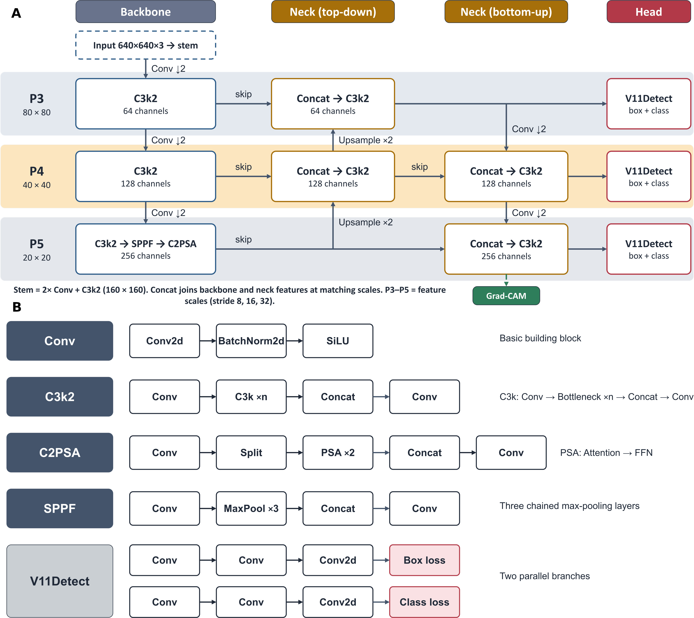

# CallusDetect-XAI

> An explainable deep learning framework for automated callus detection and quality assessment in *Phyllostachys pubescens*

**Explainable Artificial Intelligence | Deep Learning | Plant Tissue Culture | Callus Assessment**



---

## 1. Overview

**CallusDetect-XAI** is an explainable deep learning-based framework for the automated detection and quality assessment of callus tissues in *Phyllostachys pubescens* (Moso bamboo).

Conventional callus assessment in plant tissue culture primarily relies on manual visual examination by experienced researchers - a process that is subjective, time-consuming, and difficult to standardize. CallusDetect-XAI addresses these limitations by integrating an optimized YOLO11-based architecture with explainable AI (XAI) techniques to provide rapid, objective, and interpretable callus assessment.

The framework incorporates architectural optimization, automated hyperparameter tuning (Optuna), and gradient-based visual explanation techniques (Grad-CAM / Grad-CAM++) to improve classification performance while providing insights into the morphological regions influencing model predictions.

---

## 2. Key Features

- **Automated Callus Assessment** - Deep learning-based identification of optimal and non-optimal callus tissues.
- **YOLO11 Architecture** - Optimized YOLO11-based framework for callus image analysis.
- **Architectural Enhancements** - Integration of C2PSA and C3K2 modules to improve feature extraction.
- **Hyperparameter Optimization** - Optuna-based tuning for improved model performance.
- **Explainable AI** - Grad-CAM and Grad-CAM++ for visual interpretation of model predictions.
- **Morphological Assessment** - Identification of visual characteristics associated with callus quality.
- **Rapid Image Analysis** - Automated assessment supporting high-throughput tissue culture screening.

---

## 3. Framework Architecture

The CallusDetect-XAI pipeline has four major components:

1. **Image Acquisition** - Callus images collected under controlled laboratory conditions.
2. **Deep Learning Model** - Feature extraction and classification using an optimized YOLO11 architecture with C2PSA and C3K2 modules.
3. **Hyperparameter Optimization** - Optuna-based optimization of training parameters.
4. **Explainable AI** - Grad-CAM and Grad-CAM++ visualization to interpret prediction-relevant regions.

### Workflow

```
        Callus Image Acquisition
                  |
                  v
           Image Dataset
                  |
                  v
        Image Preprocessing
                  |
                  v
       Optimized YOLO11 Model
                  |
        +---------+---------+
        |                   |
        v                   v
     C2PSA                C3K2
        |                   |
        +---------+---------+
                  |
                  v
        Feature Extraction
                  |
                  v
        Hyperparameter Tuning
               (Optuna)
                  |
                  v
          Model Prediction
                  |
        +---------+---------+
        |                   |
        v                   v
    Optimal             Non-optimal
     Callus                Callus
        |                   |
        +---------+---------+
                  |
                  v
        Explainable AI Analysis
                  |
           +------+------+
           |             |
           v             v
        Grad-CAM      Grad-CAM++
           |             |
           +------+------+
                  |
                  v
      Interpretable Callus Assessment
```

---

## 4. Callus Classification

Callus samples are categorized into two classes based on observable morphological characteristics:

| Category           | Morphological Characteristics                                                                                                        |
|--------------------|--------------------------------------------------------------------------------------------------------------------------------------|
| **Optimal callus** | Soft and friable texture, cream-to-light-yellow coloration, relatively homogeneous surface, absence of visible necrotic regions.    |
| **Non-optimal callus** | Browning or dark discoloration, watery or vitrified appearance, compact or hard morphology, and/or visible necrotic regions.    |

---

## 5. Dataset Description

The dataset comprises experimentally acquired images of *Phyllostachys pubescens* callus tissues obtained under controlled laboratory conditions. The link to all the image datasets can be *[Found Here](https://drive.google.com/drive/u/1/folders/14L_7AUZbQk4r2Dpoke1PldggQVxosYLI)*

| Property              | Detail                                                                 |
|-----------------------|------------------------------------------------------------------------|
| Plant species         | *Phyllostachys pubescens* (Moso bamboo)                               |
| Image acquisition     | Controlled laboratory setup using a Nikon camera                      |
| Dataset size          | 1,920 quality-controlled images                                        |
| Classes               | Optimal callus, Non-optimal callus                                     |
| Annotations           | Based on observable callus morphological characteristics               |
| Full dataset size     | ~49 GB (available via data repository upon publication)               |

Images were collected across different plant growth regulator, temperature, and light treatment combinations.

---

## 6. Model Performance

| Evaluation Metric | Performance |
|-------------------|-------------|
| Accuracy          | **97.57%**  |
| mAP@50            | **95.23%**  |

---

## 7. Project Structure

```
CallusDetect-XAI/
├── model/
│   ├── yolo_calldetect.pt                   # YOLO detection model weights
│   └── best_model_early_stopping.pth        # DenseNet161 Grad-CAM model weights
├── CallDetect/
│   └── output/
│       └── sample_batch/                    # One folder per detection batch
│           ├── 1794200189446_sample.jpeg    # Input image
│           ├── file.png                     # Grad-CAM output heatmap
│           └── runs/                        # YOLO detection output (auto-created)
│               └── predict/
│                   ├── 1794200189446_sample.jpeg   # Annotated image with bounding boxes
│                   └── labels/
│                       └── 1794200189446_sample.txt # Detections: class x y w h confidence
├── gradcam_program.py                       # Grad-CAM & Grad-CAM++ visualization script
├── sample.png                               # Sample reference image
└── README.md
```

---

## 8. Requirements

- Python 3.8+
- PyTorch
- OpenCV
- Matplotlib
- Torchvision
- Ultralytics YOLO

### Install Dependencies

```bash
pip install ultralytics torch torchvision opencv-python matplotlib numpy
```

Verify YOLO installation:

```bash
yolo --version
```

---

## 9. Usage

### Step 1 - YOLO Object Detection

Runs detection on all images in the source folder and saves annotated results.

```bash
yolo detect predict \
  model=model/yolo_calldetect.pt \
  source=data \
  save=True \
  project=data/runs \
  save_txt=True \
  save_conf=True
```

#### Arguments

| Argument    | Value                      | Description                                               |
|-------------|----------------------------|-----------------------------------------------------------|
| `model`     | `model/yolo_calldetect.pt` | Path to the trained YOLO model weights                    |
| `source`    | `data`                     | Folder containing input images or videos                  |
| `save`      | `True`                     | Save annotated output images with bounding boxes drawn    |
| `project`   | `data/runs`                | Root directory where results will be saved                |
| `save_txt`  | `True`                     | Save detections as `.txt` label files (YOLO format)       |
| `save_conf` | `True`                     | Include confidence scores in the `.txt` label files       |

#### YOLO Output

```
data/runs/predict/
├── your_image.jpg       ← Annotated image with bounding boxes
└── labels/
    └── your_image.txt   ← class x_center y_center width height confidence
```

Label file format per line:
```
<class_id> <x_center> <y_center> <width> <height> <confidence>
```

Example:
```
0 0.512 0.489 0.342 0.278 0.94
```

---

### Step 2 - Grad-CAM Visualization

Generates **Grad-CAM** and **Grad-CAM++** heatmaps for a single image using the DenseNet161 classification model.

```bash
python3 gradcam_program.py \
  CallDetect/output/sample_batch/1794200189446_sample.jpeg \
  CallDetect/output/sample_batch/file.png
```

#### Arguments

| Position      | Example Value                                              | Description                           |
|---------------|------------------------------------------------------------|---------------------------------------|
| `sys.argv[1]` | `CallDetect/output/sample_batch/1794200189446_sample.jpeg` | Path to the input image               |
| `sys.argv[2]` | `CallDetect/output/sample_batch/file.png`                  | Path to save the output heatmap image |

#### Grad-CAM Output

The script saves a side-by-side PNG with two heatmap panels:

```
CallDetect/output/sample_batch/
└── file.png    ← Side-by-side Grad-CAM | Grad-CAM++ heatmap (300 DPI)
```

| Panel       | Method     | Description                                             |
|-------------|------------|---------------------------------------------------------|
| Left panel  | Grad-CAM   | Class activation map using averaged gradient weights    |
| Right panel | Grad-CAM++ | Improved map with pixel-wise alpha weighting            |

---

## 10. Explainable AI Methods

To improve model interpretability, CallusDetect-XAI incorporates two gradient-based visualization approaches:

**Grad-CAM** highlights the image regions contributing most to the model's prediction by computing a weighted combination of feature map activations using the global average of the gradients.

**Grad-CAM++** provides refined, class-discriminative localization by computing pixel-wise alpha weights from higher-order gradients, reducing noise and improving spatial accuracy compared to standard Grad-CAM.

Both methods operate on the last convolutional layer of the DenseNet161 model and overlay a JET colormap heatmap onto the original image to aid biological interpretation.

---

## 11. Grad-CAM Model Details

| Property         | Value                                               |
|------------------|-----------------------------------------------------|
| Architecture     | DenseNet161 (custom implementation)                 |
| Model file       | `model/best_model_early_stopping.pth`               |
| Input size       | 1000 × 1000 px                                      |
| Output           | Binary classification (1 class)                     |
| Growth rate      | 48                                                  |
| Block config     | (6, 12, 36, 24) dense layers                        |
| Device           | CUDA (`cuda:1`) with CPU fallback                   |

---

## 12. Notes

- Ensure the `data/` folder exists and contains valid image or video files before running YOLO.
- The `data/runs/` output directory is created automatically by YOLO.
- The output folder `CallDetect/output/<batch_name>/` must exist before running `gradcam_program.py`.
- Supported source formats: `.jpg`, `.png`, `.mp4`, `.avi`, and more.
- Grad-CAM requires a CUDA-capable GPU (`cuda:1`) or will automatically fall back to CPU.

---

## 13. Citation

If you use CallusDetect-XAI in your research, please cite the associated publication (details to be provided upon release).

---

## 14. License

This project is for internal/research use (CC BY-NC 4.0).
---

## 15. Repository

GitHub: [https://github.com/SCBB-LAB/CallusDetect-XAI](https://github.com/SCBB-LAB/CallusDetect-XAI)
